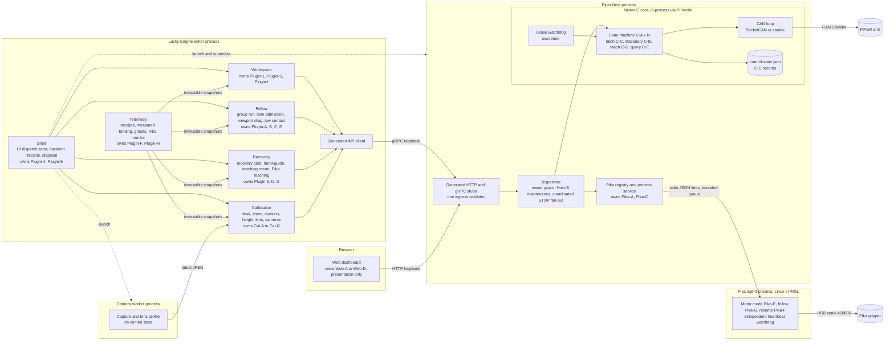

# Target architecture and state-machine spec

Status: **normative target**, written at `41d1373` on `refactor/issue-8`.
Inputs: the issue #8 audit (bugs B1–B23, dead-code table, lenses 2–5, the section 7 state-machine table, tests, OpenAPI), [control-state-machines.md](control-state-machines.md), [obstruction-recovery.md](obstruction-recovery.md), [backend-maintenance.md](backend-maintenance.md), [lucky-engine-plugin.md](lucky-engine-plugin.md) and the code.

> **Contract note.** The explicit-enum conversions in issue 8 are in progress on the `i8/native`, `i8/pika`, `i8/host`, `i8/follow`, `i8/calib`, `i8/web` and `i8/shell` branches. Section 3 is the contract they must match: state names, the events, the invariants, and the single exit or transition function for each machine. If a branch finds that the spec is wrong, the branch changes this document in the same PR. It must not silently diverge.

Words: **must** is required. **should** is the default unless there is a recorded reason. **open** means the decision is listed in section 5. Timings are copied from the code at `41d1373`. They are not new requirements.

## 0. Current shape (summary)

| Process | Language | Holds state today | Notes |
|---|---|---|---|
| Native core: in-process in `Piper.Host` through `managed_bridge.c`, or the standalone `piper-control` daemon (`main.c` + `server.c`) | C17 | Lanes (`controller_lane_fields.inc`, about 50 fields per lane), CAN devices, `control-state.json` recovery records | The daemon also serves HTTP, a camera child process, and static files. |
| `Piper.Host` + `Piper.Core` | C# | Session owner, maintenance freeze, Pika registry, coordinated STOP | HTTP and gRPC. The gRPC `Execute` call tunnels `{route, json}` strings. |
| `Piper.Pika.Agent` | C# (Linux; WSL on Windows) | Motor mode, follow session, measured-hold resume, heartbeat watchdog | stdio JSON lines to `PikaProcessService`. |
| Camera worker | C# + OpenCV/RealSense | Latest frame, lens profile | Launched by the plugin. |
| Lucky Engine plugin `PipersPlugin` | C# | About 45 partial files sharing one field namespace. It holds 22 of the 38 machines in the audit's section 7. | Uses gRPC. 125 test reflection calls reach into its private members. |
| Web dashboard | JS | Lease, approval, Pika port state | Uses HTTP only. Pika is driven through the Host (Q5). |

## 1. Principles

Each principle has a rule, the audit evidence that motivates it, and a check that shows it holds.

### P1. Single safety authority

**Rule.** For each actuator, one process is the authority for safety and for state. The native core is the authority for the PiPER arm and its CAN gripper. The Pika agent is the authority for the Pika jaws (see open question Q5). Every precondition the authority can observe (power, stillness, fresh feedback, reset completion, teaching mode, generation) is verified from hardware evidence. A client flag never stands in for it. Clients are thin. They render the authority's state, collect operator attestations, and forward requests.

**Operator attestations** are facts the controller cannot sense: the workspace is clear, the arm is supported, there is no competing leader. They are still allowed, but each one must be:
- requested by the controller in its reply (`requires: ["clear","supported"]`) for one specific action;
- echoed with that action's `confirmation_id`;
- never sent as a blanket default.

| Evidence | What goes wrong today | Target |
|---|---|---|
| B1 | `web/app.js:51`, `PipersPlugin.cs:163` and `FollowLaneController.cs:29` send `reset_completed:true`, `standalone`, `clear` and `supported` on every request. The `verify-reset` gate at `controller.c:1079` never blocks. | `verify-reset` takes no client flag. The core accepts it only when it has evidence from after the reset intent (C‑C `RESET_PENDING`, with `intent_at`). The other three become per-action attestations. |
| B6 | `range_reason` writes `c->error`, and `GET /api/state` commits the lane, so a read overwrites the real last error. | State projection is a pure function of the lane (C‑A I5). |
| Plugin‑2, Web‑B | The plugin and the web keep their own reset latch and approval and turn them into server flags. | Delete the client latches. Clients render C‑C `state` and `kind`. |
| Web‑C | `web/pika.mjs` drove Pika over Web Serial directly, which was a second authority for the jaws. | Removed (Q5 decided): the dashboard reaches Pika only through the Host. |
| Host coordinated STOP | Today the Host fans STOP out to the arm and the gripper. | The Host stays a fan-out. It reports each leg's outcome and does not decide safety itself. |

**Check.** Grep the clients for safety flags: none may be set unconditionally. Every `409` reason comes from the authority.

### P2. Explicit state machines

**Rule.** Each machine has:
- one state enum (or a tagged union, when states carry data);
- one transition function `next(state, event, evidence) → (state', effects)`;
- one exit or reset function;
- a transition table in section 3;
- table-driven tests with one row per table row, plus one test per illegal combination showing it cannot be represented or is rejected.

Recovery and UI logic switch on `state` and `kind`. They never compare message text. Human-readable text is output only.

| Evidence | Problem | Target |
|---|---|---|
| B9 | About 8 hand-written "go idle" exits each reset a different subset of fields. `op==IDLE && following` is reachable, and the next STOP records stale ages. | One `lane_exit()` resets the whole operation payload (C‑A). |
| B10 | Recovery eligibility compares `"Control action interrupted before verified completion"` and the prefix `"Possible obstruction at J"` (`controller.c:494,1233,419-420`). | A persisted `state` and `kind` (C‑C). |
| B3 | Navigation rewrites `page=="calibration"`, but the height check still tests for it, so Cal‑D is unreachable. | `enum WorkspacePage` (Plugin‑1). |
| B18, B19 | `stopPending` and `sending` are loose booleans with overlapping lifetimes. | One `phase` value per web module. |
| Audit §7 | Of the 38 machines, several rows labelled "Explicit" or "Mixed" are encoded in flags. 7 illegal combinations are reachable today (⚠). | All 38 have target shapes (section 3). |
| `teaching_phase` | Returns a string that its only caller turns back into an enum with a 6-way `strcmp`. | An enum indexes a name table. |

**Check.** `grep strcmp/strncmp` on reason or message fields in decision paths finds nothing. Each machine has a `*_transitions` test table.

### P3. One API definition

**Rule.** One schema defines every route, request, reply, error status and state frame. Server stubs (HTTP and gRPC), clients (plugin C#, web JS) and `openapi.json` are generated from it. CI fails when generated output drifts. Ingress validation (16 KiB, NUL, depth 32, unique keys, finite numbers, owner, scope) lives in one place, next to the schema.

| Evidence | Problem |
|---|---|
| B23 | The same controller exception returns 409 over gRPC and 500 over HTTP. |
| B4 | HTTP `/api/pika/state` and `/api/pika/devices` resolve the default differently from the registry. |
| B5 | An unscoped coordinated STOP without `owner` throws `KeyNotFoundException`. A schema-required field would reject it at ingress. |
| B17 | The public `ExecuteAsync("configure")` skips the arm-idle gate that the Host route applies. |
| §5 Host | `ControlJson` ingress checks are written twice with different messages. HTTP replies `{ok:false,error}` and gRPC replies `{error}`. The `transport` flag changes behaviour. |
| §9 | `web/openapi.json` documents 9 paths. All of `/api/pika/*`, `/api/shutdown`, `/api/maintenance/restart`, `/api/stop/coordinated`, and the `verify-current`, `move-to-zero` and `follow-*` actions are missing. `info.description` is stale. |
| `piper.proto` | `ControlRequest{route,json}` and `StateFrame{json}` are untyped tunnels, so the proto defines nothing. |

**Check.** One generated route table exists. A contract test sends every schema example over both transports and asserts identical status and body.

**Where it stands (stage 3).** The definition is [`managed/Piper.Contracts/piper-api.json`](../managed/Piper.Contracts/piper-api.json) (Q2). [`tools/gen-api.mjs`](../tools/gen-api.mjs) generates `web/openapi.json`, the dashboard client `web/api.mjs` and the C# route table and request builders `managed/Piper.Core/PiperApi.g.cs`; `node tools/gen-api.mjs --check` is the drift check (`make check-api`, which CI runs beside `make test-web`). The Host's dispatch, its gRPC admission, the maintenance freeze, the ingress limits and the session-owner guard read that table and name no route themselves. The C server's routes stay hand-written until stage 2 and 6; `tests/test_api.mjs` holds them to the same generated description.

### P4. Hardware-independent watchdogs

**Rule.** Every lease and heartbeat watchdog runs on its own monotonic timer. It does not depend on:
- an IO call (serial read, CAN receive, USB completion);
- a pipe or stdout write;
- an HTTP or gRPC thread;
- a lock shared with slow work (JSON snapshots).

On expiry, the watchdog drives its machine through the normal transition function to the safe state. Watchdog liveness is itself observable in state.

| Evidence | Problem |
|---|---|
| B2 | If `PumpAsync` throws, the Host marks the session disconnected but keeps `process`. The agent's synchronous `Console.WriteLine` (`Pika.Agent/Program.cs:68-71`) blocks once the pipe fills. That stalls the heartbeat and `Disable` check in the same loop (`:265`) while the jaws may be armed. Fixed in stage 5: output goes through `AgentOutput` and the watchdog has its own timer. |
| B16 | `Kill()` without the process tree leaves the WSL child alive. Nothing awaits exit. |
| Native | The arm lease (0.8 s) and follow input (0.25 s) are checked in `controller_tick`. `ControllerService` serializes tick, snapshot (`Native.State`, JSON) and commands under one `gate` lock (`ControllerService.cs:31-60`). A slow snapshot delays the watchdog. Bound it or separate it (stage 2). |
| Pika agent | The heartbeat (1.5 s), telemetry (2 s), target (6 s) and exit (8 s) checks run after a blocking serial read in the same loop. |

**Check.** Fault-injection tests block stdout, stall the serial read, stall the snapshot and kill the WSL parent. Each must reach the safe state within its stated bound plus one tick.

### P5. Components, not a god object

**Rule.** The plugin is built from components: **Workspace**, **Telemetry**, **Follow**, **Recovery**, **Calibration**, and a thin **Shell** for the UI actor, backend lifecycle and disposal. Each component:
- owns its state records;
- is the single writer of those records, from one actor thread or under one lock;
- publishes immutable snapshots;
- exposes commands as methods.

Components never share mutable fields across threads. Tests use `internal` APIs, not reflection.

| Evidence | Problem |
|---|---|
| B14 | `pikaOwned` and `pikaMonitoring` are non-volatile and written from `Task.Run` and the telemetry thread. Pika-teaching fields are written outside `pikaTeachingSync`. `GroupLane.ArmRequest`, `AdmissionTicks` and `AdmissionSequence` are shared with the heartbeat task. |
| B7 | The captured-ticks formula is copied four times, with two different clock frequencies. |
| B8 | The render path and the handler disagree on the manual Pika blocker. |
| B11, B12, B13 | STOP cleanup reuses a cancelled CTS. `DisposeAsync` does not await `heightMaintenance`. `uiEvents` is constructed after the first `Render`. These are lifecycle ordering bugs in the shared class. |
| B22 | A render projection (`AddReplayPatches`) mutates `replayTubeConfirmed`. |
| §6 | 45 partial files share one field namespace. `pikaOwned = pikaMonitoring = false` is repeated in 9 places across 6 files. Plugin‑F has about 15 writers. |
| §8 | 125 `NonPublic` reflection calls into `PipersPlugin` fail only at run time. |

**Check.** No field is written by more than one component. Render functions are pure: lint them for writes.

### P6. A small C real-time core

**Rule.** C contains only:
- the CAN loop: SocketCAN and candle transport, protocol encode/decode, feedback freshness;
- the safety machines: C‑A lane, C‑B stationary, C‑C latch and its persistence, C‑D teach evidence, the obstruction detector, the staged power sequence.

C does not contain HTTP, static files, camera children, route parsing or projection text. The C ABI takes typed commands and returns typed state. The C core makes no allocations on the tick path and does not parse JSON on it.

| Evidence | Problem |
|---|---|
| `server.c`, `camera.c` | The native daemon carries a second HTTP server and a camera child. `/api/camera*` works only there (§9). |
| §4 | `lane_action` re-tests `strcmp(route,"/api/command")` and `text_field(body,"action")` about 15 times. Route dispatch is in the safety core. |
| §1 | `PIPER_ENABLE_EXPERIMENTAL_STREAMED_POSITION` (about 300 lines) is compiled only for tests. `legacy_dir` is written and never read. |
| B20 | Windows open-failure paths leave `d->problem` empty. Transport errors must be typed (`enum can_problem`), not optional text. |

**Check.** The C core builds without `server.c`, `camera.c` or cJSON on the tick path (open, Q4). A size budget is tracked per file.

### P7. Standard testing

**Rule.**
- Use one framework per language: xUnit for C#, and one C framework (open, Q11).
- A **fake CAN bus** scripts frames and feedback with an injected clock and asserts the emitted frames.
- Scenario tests derived from the section 3 tables run in CI on every leg.
- No test exists only to keep dead code reachable.
- Fixtures are shared (`tests/fixture.h`, `TestKit`).
- Asserts never contain side effects.

| Evidence | Problem |
|---|---|
| §8 (#7) | `assert(mkdtemp(...))` and `assert(controller_init(...))` vanish under `-DNDEBUG`. A fake `fd=9` on a real-mode device. No NULL check after `cJSON_Parse`. |
| §8 | 25 copies of `Check`/`Reject` across four custom runners, and only some of them count checks. 3 C tests `#include "../src/controller.c"`. |
| §1 | Test-only production APIs: `SimulationFollowPolicy`'s instance API, `EpisodeReplayPlanner`, `TeachingResetAssisted`, `AlignmentCheck`, and the `test_streamed_*` suites. |
| §8 | The C tests repeat the device fixture 29 times, `mkdtemp` 24 times and the `__wrap_piper_now` boilerplate 16 times. About 30 near-identical Makefile rules. |
| §8 | `test_camera.c` silently skips half the test without `ffmpeg`. `Piper.Host.Tests` runs only on Ubuntu. The managed Linux fixture fails on the `null`/`""`/`"Ubuntu"` distribution convention. |

**Check.** Every section 3 row maps to a test ID. Coverage of the tables is reported in CI.

## 2. Target component diagram



**State ownership.** Every machine has exactly one writer.

| Owner (process) | Authoritative state | Others may only |
|---|---|---|
| Native core (Host process) | C‑A to C‑E per lane, C‑C persisted record, CAN device generation | Read the state frame; send commands that the core admits or rejects |
| Pika agent | Pika‑E, Pika‑F, Pika‑G, jaw power | Request through the agent. The Host keeps evidence of the agent's reports (Pika‑A power evidence), not the decision. |
| Host dispatcher | Host‑B, session owner, Pika‑A process phase, Pika‑C assignment | Read |
| Plugin components | Presentation machines (Plugin‑*, Cal‑*) | — |
| Web | Web‑A to Web‑D (presentation and request lifetime) | — |

The standalone native daemon (`main.c` + `server.c`) is drawn out. Whether it stays is open (Q4). If it stays, it hosts the same core and generated API. It is not a second implementation.

## 3. State-machine spec

**Conventions.**
- `S` column: **SC** marks a safety-critical authority machine. It needs full transition-table tests, fault injection and a hardware checklist. **SR** marks a safety-relevant client machine: its errors can only produce a rejected, late or extra request, and it must never be an authority. **—** marks presentation only.
- "→ `X`" means a transition to state `X`. `[outcome]` is the recorded exit outcome.
- Unlisted (state, event) pairs are **rejected with no state change**. For a request that is a 409 naming the current state.
- Illegal combinations from the audit must become unrepresentable (union payloads) or must be asserted.

### 3.1 Native core (owner: C)

#### C‑A Lane operation — **SC** — full table

Shape: `struct lane_op { enum lane_phase phase; union { power, motion, follow, cycle, align, gripper, teach } u; }`, plus per-lane `last_outcome`. The single exit is `lane_exit(lane, outcome, stop_kind, reason)`. It zeroes the whole union and owner and request fields, retires the request ID, and is the only writer of `phase = LANE_IDLE`. The API `phase` string is derived from `phase` through a table, so the `phase[32]` field goes away.

| State | Replaces today | Payload |
|---|---|---|
| `IDLE` | `op==OP_IDLE` | `last_outcome ∈ {NONE, COMPLETE, HELD, STOPPED, ABANDONED, RELINQUISHED, BLOCKED}` |
| `ENABLING` | `OP_ENABLE` + `enable_*[6]` | cursor, per-driver requested/acked/first/last send, baseline |
| `DISABLING` | `OP_DISABLE` + `disable_*[6]`, `disable_keeps_recovery` | cursor, per-driver arrays, `keeps_recovery` |
| `RESETTING` | `OP_RESET` | `sent_at` |
| `SEEDING` | `position_seed_pending` | frozen `initial[6]`, `next ∈ {MOVING, ALIGNING, CYCLE_RAISING}` |
| `MOVING` | `OP_MOVE` (+`synchronized_pose`) | target, command, `sync: bool`, speed, tolerance |
| `ARRIVAL_HOLD` | `arrival_hold` | hold pose, `origin ∈ {MOVING, ALIGNING}` |
| `ALIGNING` | `OP_ALIGN` (+`range_followup`) | optional `followup {target, speed, percent}` |
| `CYCLE_RAISING` / `CYCLE_UPRIGHT` / `CYCLE_RETURNING` | `OP_CYCLE`, `cycle_stage` 1/2/3 | initial pose, `pause_until` |
| `FOLLOWING` | `following` | sequence, `updated_at`, `transport` (`POSITION_VELOCITY` or `TRAJECTORY` with its limits) |
| `FOLLOW_COMMITTED` | `follow_committed` | released target |
| `GRIPPER` | `OP_GRIPPER` | target, command, effort, max width |
| `TEACH_STANDBY` / `TEACH_CAN` | `OP_TEACH_RETURN`, stage 1/2 (legacy firmware) | `sent_at`, frozen pose |
| `TEACH_SEED` / `TEACH_HOLD` | stage 3/4 (seamless firmware) | `sent_at`, frozen pose, `recovery: bool` (was `recovering_at_pose`) |

The streamed-position transport (`streamed_position_mode`) is not a target state. It is being deleted in issue 8 (Q1).

**Global events.** These apply in the listed states. Each is checked before the per-state rows.

| # | From | Event / evidence | To `[outcome]` | C‑C effect |
|---|---|---|---|---|
| G1 | any ≠ `IDLE`, `TEACH_*` | `/api/stop`, which carries one of two intents (`enum stop_intent`, reported as `stop_intent`). **Emergency** (no well-formed `request_id` tied to a known arm): never refused without stopping. A known `device_id` stops that arm even when `generation` is stale or malformed, the `owner` differs or `request_id` is malformed; a scope that names no known arm stops every arm. **Cancel** (known `device_id` and a well-formed `request_id`): stops that action only while it is still the current request of that arm for that `owner`; otherwise 409, no frame, no latch, and this row does not fire. All STOP frames are sent before the records are saved; a scope that was not honoured replies 409 with `stop_scope`, `stop_scope_reason` and `stops` | `IDLE [STOPPED]`, STOP frame (+ gripper 0 if `GRIPPER`) | → `INCIDENT(operator_stop)`; first event kept |
| G2 | any ≠ `IDLE`, `TEACH_*` | lease age ≥ 0.8 s (tick or heartbeat) | `IDLE [STOPPED]` | → `INCIDENT(lease_expired)` |
| G3 | `TEACH_*` | lease age ≥ 0.8 s | `IDLE [ABANDONED]`, no STOP | none |
| G4 | any ≠ `IDLE`, `TEACH_*` | adapter absent or generation ≠ pinned | `IDLE [STOPPED]` | → `INCIDENT(transport)` |
| G5 | `TEACH_*` | adapter absent or generation changed | `IDLE [ABANDONED]` | none |
| G6 | any ≠ `IDLE`, `FOLLOWING`, `TEACH_*` | deadline: `ENABLING`/`DISABLING` 8 s; `MOVING`/`ALIGNING`/`ARRIVAL_HOLD`/`FOLLOW_COMMITTED`/`GRIPPER` 120 s; `CYCLE_*` 180 s; `RESETTING` 3 s; `SEEDING` inherits its `next` phase deadline | `IDLE [STOPPED]` | → `INCIDENT(timeout)`; `RESET_PENDING` retained |
| G7 | any ≠ `IDLE`, `TEACH_*` | health check fails (`CHECK_RESET` in `RESETTING`, `CHECK_POWER` in `DISABLING`, otherwise `CHECK_CONTROL`) | `IDLE [STOPPED]` | → `INCIDENT(health)` |
| G8 | any ≠ `IDLE`, `TEACH_*` | benign onboard teaching observed (`RESETTING`/`DISABLING`: only with a real teaching status) | `IDLE [RELINQUISHED]` | `INTENT(action)` → `CLEAR`. Other states unchanged. |
| G9 | `MOVING`, `ALIGNING`, `CYCLE_*`, `FOLLOW*`, `SEEDING` | motor enable lost; CAN MoveJ mode not entered 0.5 s after send | `IDLE [STOPPED]` | → `INCIDENT(health)` |
| G10 | `MOVING`, `ALIGNING`, `CYCLE_*`, `FOLLOW*` | obstruction detector stall (0.5 s without progress, [obstruction-recovery](obstruction-recovery.md)) | `IDLE [STOPPED]`, `joint` recorded | → `INCIDENT(obstruction, joint)` |
| G11 | `FOLLOWING(TRAJECTORY)` | deviation > 3° from the commanded path | `IDLE [STOPPED]` | → `INCIDENT(tracking)` |
| G12 | any ≠ `IDLE` | controller close | `TEACH_*`: `[ABANDONED]`, otherwise `[STOPPED]` | otherwise → `INCIDENT(shutdown)` |
| G13 | any | persistence write fails | unchanged; `storage_failed` latched in memory; every later admission → 409 until restart | in-memory record keeps the pre-write state |

**Admission from `IDLE`.** Every admission requires an owner of 16–80 characters, `storage_failed == false`, and the action's guards. Motion admission also requires `controller_blocker == NULL`: fresh healthy feedback, C‑C `CLEAR`, current limits. The C‑C write must succeed **before** the first frame.

| # | Request | Extra guard | To | C‑C before first frame |
|---|---|---|---|---|
| A1 | `enable` | — | `ENABLING` | `CLEAR` → `INTENT(action)` |
| A2 | `pose` / `move-to-zero` / joint move inside range | all six motors enabled | `SEEDING(next=MOVING, sync = zero or synchronized)` | → `INTENT(action)` |
| A3 | move whose start is outside range, inward or to zero, correction ≤ 3° | as A2 | `SEEDING(next=ALIGNING, followup=requested)` at 1 % | → `INTENT(action)` |
| A4 | `align` (range entry only) | as A2 | `SEEDING(next=ALIGNING)` | → `INTENT(action)` |
| A5 | `cycle` | current pose is a valid target | `SEEDING(next=CYCLE_RAISING)`, 3°/s, tolerance 0.2° | → `INTENT(action)` |
| A6 | `follow-start` (`trajectory` optional) | permitted transport; limits captured | `FOLLOWING(transport)`, no seed | → `INTENT(action)` |
| A7 | gripper width | gripper configuration and feedback verified | `GRIPPER` | → `INTENT(action)` |
| A8 | `disable` | attestation `supported`; `CHECK_POWER` | `DISABLING(keeps_recovery = state≠CLEAR or unhealthy)` | `CLEAR` → `INTENT(disable)`; otherwise unchanged |
| A9 | `reset` | attestations `supported`, `clear`; `CHECK_POWER`; stationary 0.4 s; supported teach/control state; if already `RESET_PENDING`, only at a stopped, all-off, error-free pose | `RESETTING`, reset frame. If the TX fails → `IDLE [BLOCKED]`. | → `RESET_PENDING(intent_at=now)` |
| A10 | `teach-return` (legacy firmware) | `control==2`; `teaching_return_guard`; attestations | `TEACH_STANDBY`, standby frame. TX fail → `IDLE [ABANDONED]`. | none |
| A11 | `teach-return` (seamless firmware) | as A10 | `TEACH_SEED(recovery=false)`, 3 seed frames. TX fail → `IDLE [STOPPED]`. | none (on STOP → `INCIDENT`) |
| A12 | `recover-at-pose` | seamless firmware; C‑C `INCIDENT(kind=obstruction)` recoverable (see C‑C); C‑D `COMPLETED` | `TEACH_SEED(recovery=true)`; C‑D → `NONE` (one attempt per cycle) | unchanged until H5 |
| A13 | `verify-current`, `verify-reset`, `verify-disabled` | see C‑C | stays `IDLE` | per C‑C |
| A14 | `teach-return` while the arm already reports CAN standby and is not teaching | `CHECK_CONTROL` | stays `IDLE` (200, nothing sent) | none |

**Per-state transitions.** "Settled" means: the final command was sent, feedback is newer than that send, error ≤ tolerance, the arrival acknowledgement holds, and this has lasted 0.4 s.

| # | From | Event / evidence | To `[outcome]` | C‑C |
|---|---|---|---|---|
| S1 | `SEEDING` | pose drift > 0.5° from frozen pose, or target invalid | `IDLE [STOPPED]` | → `INCIDENT` |
| S2 | `SEEDING` | 3 seed frames sent | `next` (cycle and sync legs issued) | — |
| S3 | `SEEDING` | seed TX fails | `IDLE [STOPPED]` | → `INCIDENT(transport)` |
| M1 | `MOVING` | settled, `motion_status==0` | `IDLE [COMPLETE]` | `INTENT` → `CLEAR` |
| M2 | `MOVING`, `ALIGNING` | settled within tolerance and independently stationary, but `motion_status==1` | `ARRIVAL_HOLD(origin)`, legal measured hold sent. If the hold is invalid or TX fails → `IDLE [STOPPED]`. | — |
| M3 | `MOVING`, `CYCLE_*` | `hold` from the owner (request ID matches if given), `CHECK_POWER` passes | `MOVING(sync=false, target=measured)`; cycle deadline restarts | — |
| M4 | `ARRIVAL_HOLD` | measured through `settled_at + 0.4 s` at the hold pose | origin's completion: `MOVING` → M1; `ALIGNING` → L2/L3 | — |
| L1 | `ALIGNING` | `hold` from the owner, same device, generation and request | `IDLE [STOPPED]` (an out-of-range pose cannot be encoded as a hold) | → `INCIDENT(operator_stop)` |
| L2 | `ALIGNING` with followup | settled; range distance 0; followup valid | `MOVING(sync=true, followup)` | — |
| L3 | `ALIGNING` with followup | settled, but range ≠ 0 or followup invalid | `IDLE [STOPPED]` | → `INCIDENT(range)` |
| L4 | `ALIGNING` without followup | settled | `IDLE [COMPLETE]` | → `CLEAR` |
| Y1 | `CYCLE_RAISING` | settled | `CYCLE_UPRIGHT(pause_until = now + 2 s)` | — |
| Y2 | `CYCLE_UPRIGHT` | not settled | same state, `pause_until` reset | — |
| Y3 | `CYCLE_UPRIGHT` | `now ≥ pause_until`, still settled | `CYCLE_RETURNING(target = initial)` | — |
| Y4 | `CYCLE_RETURNING` | settled (0.2°) | `IDLE [COMPLETE]` | → `CLEAR` |
| F1 | `FOLLOWING` | `follow-update`: owner, device, generation and request match; sequence > last; 6 finite angles; healthy; all enabled; valid | same state; target and sequence updated; lease renewed | — |
| F2 | `FOLLOWING` | input age ≥ 0.25 s (tick or request) | measured hold: on success `IDLE [HELD]`, on failure `IDLE [STOPPED]` | `CLEAR` / → `INCIDENT(follow_hold)` |
| F3 | `FOLLOWING`, `FOLLOW_COMMITTED` | `follow-end` or `hold` | as F2 | as F2 |
| F4 | `FOLLOWING(POSITION_VELOCITY)` | `follow-commit` (F1 guards) | `FOLLOW_COMMITTED`; deadline restarts | — |
| F5 | `FOLLOWING(TRAJECTORY)` | `follow-commit` | rejected 409; unchanged | — |
| F6 | `FOLLOWING(TRAJECTORY)` | feasibility boundary, after G10 and G11 pass | as F2 | as F2 |
| F7 | `FOLLOW_COMMITTED` | settled | `IDLE [COMPLETE]` | → `CLEAR` |
| F8 | `FOLLOW_COMMITTED` | `follow-update` | rejected 409 ("already released") | — |
| P1 | `ENABLING` | all six drivers acknowledged with feedback newer than their own request; settled 0.4 s | `IDLE [COMPLETE]` | → `CLEAR` |
| P2 | `ENABLING` | drift > 0.5° from a requested joint's baseline (> 1° total for joints not yet requested); acknowledged enable lost; TX fails | `IDLE [STOPPED]` | → `INCIDENT` |
| P3 | `ENABLING`, `DISABLING` | tick ≥ 20 ms since last send | send the next driver; retry only a missing ACK after 150 ms | — |
| P4 | `DISABLING` | fresh all-off, acknowledged, no error, stationary 0.4 s | `IDLE [COMPLETE]` | `keeps_recovery` ? unchanged : → `CLEAR` |
| P5 | `DISABLING` | TX incomplete | `IDLE [STOPPED]` | → `INCIDENT` (cleanup error recorded in `last_cleanup_error`; primary event kept) |
| R1 | `RESETTING` | status newer than `sent_at`; no error; `arm_status==0`; all off; stationary 0.4 s | `IDLE [COMPLETE]` | `RESET_PENDING` → `CLEAR` |
| G‑1 | `GRIPPER` | fresh width within 0.5 mm, or effort-limited completion | `IDLE [COMPLETE]` (effort-limited does **not** verify a grasp) | → `CLEAR` |
| G‑2 | `GRIPPER` | `hold` from the owner with fresh gripper feedback and a live lease, after a target was sent | `IDLE [COMPLETE]` ("ramp stopped") | → `CLEAR` |
| T1 | `TEACH_*` | fresh, `control ≤ 1`, not teaching, any joint > 0.5° from frozen pose | `IDLE [STOPPED]` | → `INCIDENT(teach_handoff_motion)` |
| T2 | `TEACH_*` | guard fails, or pose drift > 0.5° (other cases), or mode outside the expected sequence, or 1.5 s without the mode ACK | `IDLE [ABANDONED]`, no STOP | none |
| T3 | `TEACH_STANDBY` | status newer than send, `control==0` | `TEACH_CAN`, CAN mode frame. TX fail → `IDLE [ABANDONED]`. | — |
| T4 | `TEACH_CAN` | `control==1 && motion_mode==1` | `IDLE [COMPLETE]` | none |
| T5 | `TEACH_SEED` | `control≠2` on newer status | `IDLE [ABANDONED]` | none |
| T6 | `TEACH_SEED` | ≥ 20 ms; every joint and motor sample newer than the seed; `control==2` | `TEACH_HOLD`, mode + frozen pose at 1 %. TX fail → `IDLE [STOPPED]`. | — |
| T7 | `TEACH_HOLD` | `control==1 && motion_mode==1`; joints (and motors, on hardware) newer than send | `recovery` ? H5 : `IDLE [COMPLETE]` | — |
| H5 | `TEACH_HOLD(recovery)` | T7 holds | transactional clear OK → `IDLE [COMPLETE]`; storage fails → `IDLE [BLOCKED]` | `INCIDENT` → `CLEAR`, or stays `INCIDENT` |

**Invariants (asserted in `lane_exit` and after every transition).**

| # | Invariant |
|---|---|
| I1 | `phase == IDLE` ⇔ owner empty, the request retired and the union zeroed. This closes B9. |
| I2 | `FOLLOWING` and `FOLLOW_COMMITTED` are distinct phases. `cycle_stage` and `teach_return_stage` no longer exist outside their phases. |
| I3 | A phase that can transmit a position, mode, power or reset frame is entered only after its C‑C write succeeded. |
| I4 | The generation is pinned at admission. Every frame carries it. |
| I5 | State projection (`controller_state`) is read-only for the lane, `error` and C‑C (B6). Getters such as `controller_any_motion_active` never rebind the selected lane (C‑F). |
| I6 | A STOP event is built from the lane snapshot **before** `lane_exit` runs, so following ages and sequence are only recorded while following. |
| I7 | `TEACH_*` never sends STOP on lease, guard or timeout failure. Only T1 (unexpected motion after CAN acceptance) stops. |
| I8 | Lease (0.8 s) and follow input (0.25 s) are evaluated on every tick by the watchdog, even when no API traffic arrives (P4). |
| I9 | The rows are exhaustive. Any other (phase, event) pair is rejected and leaves the state unchanged. |

#### C‑C Persistent recovery latch — **SC** — full table

Persisted per device in `control-state.json`:

```json
{ "state": "clear|intent|incident|reset_pending",
  "kind": "action|disable|operator_stop|lease_expired|timeout|health|transport|obstruction|tracking|range|follow_hold|teach_handoff_motion|shutdown|legacy",
  "intent_at": 0, "reason": "display text only",
  "stop_event": { "kind": "...", "joint": 0, "...": "existing evidence fields" },
  "last_fault": {}, "last_cleanup_error": "" }
```

`kind` names the *first* cause that still needs recovery. `stop_event` is immutable from the first STOP until `CLEAR`. That keeps the current "later STOP commands cannot overwrite that event" rule. `reason` is display text only, and no code may branch on it.

| State | Today's encoding | Motion admission |
|---|---|---|
| `CLEAR` | `!blocked`, `!stop_event_active`, legacy acknowledged | allowed (subject to C‑A) |
| `INTENT` | `blocked`, reason = "Control action interrupted…" or the disable intent, `!stop_event_active` | rejected unless the lane owns it (survives a crash, and then needs verification) |
| `INCIDENT` | `blocked && stop_event_active` | rejected; recovery actions only |
| `RESET_PENDING` | `blocked && reset_pending` (± a retained incident) | rejected; only `reset` retry or `verify-reset` |
| *(migration)* `LEGACY_UNACKED` | `legacy_stops` entry with `at ≠ legacy_ack` | Read once on load and converted to `INCIDENT(kind=legacy)`. The legacy reader is deleted in stage 6 (Q9). |

| # | From | Event | Guard (hardware evidence unless marked *attest*) | To |
|---|---|---|---|---|
| L1 | `CLEAR` | C‑A A1–A7 admission | write succeeds | `INTENT(kind=action, intent_at)` |
| L2 | `CLEAR` | A8 `disable` | write succeeds | `INTENT(kind=disable)` |
| L3 | `INTENT(action)` | C‑A `COMPLETE` (M1, L4, Y4, F7, P1, G‑1/2) or `HELD` (F2/F3) | write succeeds | `CLEAR` |
| L4 | `INTENT(action)` | C‑A `RELINQUISHED` (G8) | intent belongs to this lane and is not a stop or reset | `CLEAR` |
| L5 | `INTENT(disable)` | P4 with `keeps_recovery == false` | — | `CLEAR` |
| L6 | `CLEAR`, `INTENT` | any STOP (C‑A G1–G12, S1, S3, M2, L1, L3, F2, P2, P5, T1, T6) | — | `INCIDENT(kind)`, `stop_event` created, `last_fault` captured if fresh |
| L7 | `INCIDENT` | another STOP | — | `INCIDENT`; `stop_event` unchanged; a disable-cleanup failure sets `last_cleanup_error` |
| L8 | `RESET_PENDING` | any STOP | — | `RESET_PENDING`; incident retained |
| L9 | any | A9 `reset` admission | *attest* `supported`, `clear`; healthy for power; stationary 0.4 s; if already `RESET_PENDING`, a fresh stopped all-off error-free pose | `RESET_PENDING(intent_at = now)`, then the reset frame |
| L10 | `RESET_PENDING` | C‑A R1 (core-observed reset completion) | status newer than `sent_at`, all off, no error, stationary 0.4 s | `CLEAR` |
| L11 | `RESET_PENDING` | `verify-reset` (external reset or power cycle) | all six off, healthy, stationary 0.4 s, **status and motor samples newer than `intent_at`**. No `reset_completed` flag (B1). Whether an observable power-cycle signature exists is open (Q7). | `CLEAR` |
| L12 | `INTENT`, `INCIDENT` | `verify-disabled` | all off, healthy, stationary 0.4 s; not `RESET_PENDING` | `CLEAR` |
| L13 | `INTENT`, `INCIDENT` | `verify-current` | *attest* `clear`, `supported`; `CHECK_CONTROL`; consistent power (all on or all off); stationary 0.4 s; not `RESET_PENDING` | `CLEAR` |
| L14 | `INCIDENT(kind=obstruction)` | C‑A H5 | recoverable: no reset pending, legacy acknowledged, no `last_fault`, no device problem, no transport failure, `stop_event.error==0`, `arm_status==0` | `CLEAR` (transactional) |
| L15 | any | write fails during a transition | — | the pre-transition state stays in memory; `storage_failed` |
| L16 | `LEGACY_UNACKED` | load | — | `INCIDENT(kind=legacy)` |

| # | Invariant |
|---|---|
| C1 | `stop_event` present ⇔ `state ∈ {INCIDENT}` or (`RESET_PENDING` with a retained incident). `stop_event_active && !blocked` and `reset_pending && !blocked` cannot be represented. |
| C2 | The record is persisted (fsync plus directory fsync, or `MOVEFILE_WRITE_THROUGH`) before any CAN frame that the new state authorizes. |
| C3 | Eligibility (L14, L4, admission) reads `state` and `kind` only (B10). |
| C4 | No client field can move the state. Attestations are recorded alongside the transition, with the confirmation ID, for audit. |
| C5 | A restart preserves the state. `INTENT` after a restart means "interrupted before verified completion". |

#### Other native machines

| Machine | S | Target states | Key transitions | Invariants |
|---|---|---|---|---|
| **C‑B Stationary detector** (`canbus.c:191-283`) | SC (evidence for reset, enable, verify, teach) | `UNKNOWN`, `MOVING`, `POSE_QUIET(since)`, `STRICT_STILL(since)` | coherent samples agree → `POSE_QUIET`; strict velocity and position agreement → `STRICT_STILL`; motion or gap → `MOVING`; `lost()`, reconnect or generation change → `UNKNOWN` | One enum plus a timestamp. The `*_moving` flags are deleted. `since > 0` implies quiet. Both `lost()` implementations agree. Fixtures may not hand-build impossible combinations. |
| **C‑D Teach-cycle evidence** | SC (gates A12 and teach return) | `NONE`, `SEEN(generation, at)`, `COMPLETED(at)`, `EXPIRED` | teaching status seen → `SEEN`; benign end on the same generation → `COMPLETED`; 120 s after completion, STOP, disconnect, fault, playback or a recover-at-pose attempt → `NONE` | `teaching_cycle_device` is deleted (always the lane's own device). `COMPLETED` requires an earlier `SEEN`. Never restored from disk. |
| **C‑E Info query** | — | `IDLE`, `INITIAL(index)`, `RETRY(cursor)` | idle with config missing for 5 s, or reconnect → `INITIAL`; per-item 80 ms pacing; 5 s deadline → `RETRY` or `IDLE` with blocker | Separate counters per phase (one counter serves two phases today). Deferred while the lane is busy. |
| **C‑F Selected-lane projection** | SC (wrong-arm risk) | none: removed | Every function takes `struct controller_lane *` explicitly. `selected` is a UI projection only. | No `commit_lane`/restore pairs (10 and 12 today). Getters are pure. Requests carry `device_id` (Q10). |
| Staged power (inside `ENABLING`/`DISABLING`) | SC | payload, not a separate machine | P1–P5 | One `power_round_robin(on)` (§5) replaces the twin arrays. |

### 3.2 Host (owner: `Piper.Host`)

| Machine | S | Target states | Key transitions | Invariants |
|---|---|---|---|---|
| **Host‑B Maintenance freeze** (`BackendMaintenance.cs`) | SC (admission during shutdown and restart) | `Open`, `Checking(op, owner)`, `Prepared(op, owner, commit)`, `Committed(op)`, `Exiting`, `Failed(reason)` | request after transport and owner admission → `Checking`; checks pass → `Prepared` (freeze active); response drained → `Committed` → recheck → `Exiting` (exit 0 for shutdown, 75 for restart); any recheck fails or physical change → `Failed` → `Open` | `Prepare` returns a one-shot commit, so `committed` and `preparedOwner` disappear. STOP and coordinated STOP are admitted in every phase. `pending` is shown only in `Prepared`/`Committed`. The HTTP-only shutdown route cannot enter from gRPC. |
| **Host‑S Coordinated STOP** (added; P0 in the inventory) | SC | per leg: `Pending`, `Acked`, `Failed`, `TimedOut`, `Unverified` | scope classified at ingress (unscoped = emergency, needs no `owner`; B5 closed) → legs run independently, 3 s each | One leg's failure never blocks the other. An unresolved Pika → `Unverified`. An unscoped STOP is never refused by the session-owner guard and holds every gripper; so does a STOP whose scope cannot be honoured, which reports that leg failed. The Host does not retry or decide safety. |

### 3.3 Pika (owners: Host process service and the agent)

| Machine | S | Target states | Key transitions | Invariants |
|---|---|---|---|---|
| **Pika‑A Agent process + power evidence** (`PikaProcessService.cs`) | SC | `AgentPhase`: `Idle`, `Launching`, `Ready`, `Faulted`, `Closing`, `Exited`. `PowerEvidence`: `None`, `Requested(id)`, `Acked(id)`, `VerifiedDisabled(at)`, `Uncertain` | connect → `Launching`; READY within 15 s → `Ready`, otherwise → `Faulted`; pump exception, EOF or a malformed line → `Faulted` (B2); `Faulted` → kill the tree, await the pump → `Exited`; close → `Closing` (drain stdin, 3 s) → `Exited` (`Kill(true)` on timeout, B16); `Exited` → `Idle` after reap. Power: an enable or position request → `Requested` → ACK within 3 s → `Acked`; newer disabled feedback under 2 s → `VerifiedDisabled`; exit or kill while `Requested`/`Acked` → `Uncertain` | `process ≠ null` ⇔ phase ∈ {Launching, Ready, Faulted, Closing}. `owner ≠ null` ⇔ `process ≠ null`. Connect in `Faulted`/`Closing` returns that phase, not "Session already connected". Takeover is blocked while `Uncertain`. Each decision takes one locked snapshot (B15). `processConfirmedExited` is deleted. |
| **Pika‑C Registry assignment** (`PikaSessionRegistry.cs`) | SC (routes power to a device) | per `PikaKey(device, distribution?)`, a `record struct`: `Unassigned`, `Assigned(default)`, `Registered`, `Open`. Aliases: `Bound`, `Released` | configure (arm-idle authorizer **required**, B17) → `Assigned`; connect → `Open`; release → `Registered`; clear → `Unassigned`, aliases released | `null` distribution = native Linux everywhere (`PikaDistribution` is the single source; it fixes the managed CI fixture). An explicit null is never defaulted. Cap 16 entries. HTTP state and device routes resolve the default through the registry (B4). |
| **Pika‑E Agent motor mode** (`Pika.Agent/PikaAgent.cs`) | SC | `ReadOnly`, `EnableRequested`, `Enabled`, `Targeting(goal)`, `Following`, `FollowHolding`, `Resuming`, `Disabling` | enable with finger-clear, fresh fault-free feedback → `EnableRequested` → newer enabled feedback → `Enabled`; position → `Targeting` → within tolerance 0.15 s → `Enabled`; follow-start → `Following` → expiry with valid enabled feedback → `FollowHolding`; resume-hold → `Resuming` (Pika‑F); heartbeat > 1.5 s, telemetry > 2 s or target > 6 s (not in `FollowHolding`) → `Disabling` → `ReadOnly`; `FollowHolding` with no heartbeat or no telemetry > 30 s (`HoldingGraceSeconds`) → `Disabling` → `ReadOnly`; no heartbeat > 8 s and not holding → exit; closed input, SIGINT/SIGTERM/SIGHUP/SIGQUIT, process exit, a Host that stopped reading output, or a serial fault → `Disabling` (if power was ever written) → exit | One `MotorMode`. A target while following, and arming while resuming, are unrepresentable. `wrotePower` is cleared on `ReadOnly`. The watchdog runs on its own timer and the output queue is bounded and non-blocking (P4). `FollowHolding` keeps torque without a heartbeat for a fixed 30 s only (Q6, decided). |
| **Pika‑F Measured-hold resume** | SC | `Pending`, `Verified`, `Failed`, `Cancelled` | fresh disabled stationary opening → seed → enable → seed → newer same-opening feedback within 1.5 s → `Verified`; drift > 1 mm, loss or write failure → `Failed` (one disable); STOP → `Cancelled` | `Active`/`Succeeded` are derived. `Audit.Outcome` is the enum. Feedback age < 750 ms; admission agreement 0.25 mm. |
| **Pika‑G Follow session** (`PikaFollowSession.cs`) | SC | `Idle`, `Following(session, seq)`, `Holding`, `HoldFailed(reason)` | start → `Following`; input or feedback older than 250 ms with valid enabled feedback → `Holding`, otherwise → `HoldFailed`; fault, lost feedback or write failure → `HoldFailed`; restart or acknowledgement → `Idle` | A failed hold is visible (today it is silently `Idle`). Stale session IDs and non-increasing sequence numbers are rejected. |

### 3.4 Plugin (owner: the named component)

Every plugin machine is a client of an authority. None may be **SC**.

| Machine (component) | S | Target states | Key transitions | Invariants |
|---|---|---|---|---|
| **Plugin‑1 Workspace navigation** (Workspace) | — | `WorkspacePage {Controls, Recording, Replay, Camera(detail, returnPage), Settings(SettingsCategory {Robot, Cameras, Bench, Diagnostics})}` | `Navigate(candidate)` → guard and cleanup → commit under the publication gate → confirmed epoch, or keep the old view. The profile switch uses the same path (today it writes the page directly). | `calibrationOpen` is derived from `Settings(Bench)` (B3). `"controller"` and `backendSetupOpen` are deleted unless Q12 keeps them. |
| **Plugin‑2 Legacy reset latch** (Recovery) | SR | deleted | — | Recovery renders C‑C `state`/`kind`. Acknowledgement fields move into the Plugin‑3 or recovery-operation record. |
| **Plugin‑3 Hand-guide recovery** (Recovery) | SR | `RecoveryGuide?`: `Open(incident, connection)`, `Armed`, `SawGuiding`, `CommandSent(request)`, `Done(result)` | open on `INCIDENT(obstruction)` → arm → C‑D `SEEN` → off and still receipt → send `recover-at-pose` once → C‑A outcome → `Done`. A new incident replaces the whole record. | `CommandSent` requires a request ID. One reset replaces the partial resets (`:322` resets 3 of 6 fields). |
| **Plugin‑4 Owned backend + restart** (Shell) | SR | `External`, `OwnedStarting`, `OwnedReady`, `ConfirmRestart`, `Restarting`, `Relaunching`, `Failed` | launch → ready receipt → `OwnedReady`; restart request → `ConfirmRestart` → Host‑B 202 → `Restarting` → child exit 75 and ports free → `Relaunching` → `OwnedReady`; unexpected exit → `Failed` | An exited process clears the handle and token. The state is published as an immutable record (it is read cross-thread). An external process is never shut down. |
| **Plugin‑5 Primary action** (Workspace) | SR | `Idle`, `Received`, `Confirming`, `Enabling`, `LinkScene`, `Done`, `Failed` | per the inventory P0 row; each async stage re-reads live evidence | One busy derivation. Status has one writer. |
| **Plugin‑6 UI dispatch actor** (Shell) | SR (STOP latency) | `Open`, `Running(normal / urgent)`, `UrgentPending`, `Closing`, `Closed`, `Disposed` | an urgent Disable preempts, then drains; STOP bypasses the actor | Constructed before the first `Render` (B13). `closed` and `stopping` are merged. The queue is bounded. |
| **Plugin‑A Group lane admission** (Follow) | SR | `Untouched`, `MatchRequested(MatchRequest)`, `Settling`, `Matched`, `Admitted(FollowRequest)`, `PikaFollowing`, `Executing`, `Released` | per lane, under the group phase | `MatchRequest` and `FollowRequest` are separate types, so heartbeats can tell them apart. `Settled*` is cleared on `Matched`. `PikaSession` requires `PikaTouched`. Single writer (B14). Admission uses `TelemetryReceipt.CapturedTicks(freq)` (B7). |
| **Plugin‑B Outer Follow lifecycle** (Follow) | SR | `Idle`, `Discovering`, `WaitingForPlay`, `Session(GroupPhase)`, `Summary(outcome)`, `SetupFailed` | per the inventory group row; `WaitingForPlay` = `Arming/Armed` with no run ID | One `outcome` enum, because failure and retirement can both be set today. |
| **Plugin‑C Viewport joint drag** (Follow) | SR | `Off`, `TeleopIdle`, `GestureAccepted`, `Following(request)`, `Committed`, `Held` | gesture → C‑A A6; updates → F1; release → F4 or F3 | One reset function (5 sites today). A failed `follow-start` cannot leave the state `Active`. |
| **Plugin‑D Teaching ownership + auto-return** (Recovery) | SR | `Idle`, `Guiding`, `EligibleReturn`, `Attempted` | mirrors C‑D; one return attempt per cycle | `TeachingState.Phase` becomes a real enum. Approval binds only after `Guiding` has been seen. |
| **Plugin‑E Ordered jaw contact** (Follow) | SR | `Unresolved`, `Opened`, `ContactQualified(ContactRecord)`, `LosingContact(since)`, `MissedGrasp` | per `OrderedSimulationExecution` | A NaN sentinel cannot be represented. Qualification carries its resolved command. |
| **Plugin‑F Pika monitor + ownership** (Telemetry) | SR | `Idle`, `Backoff(until)`, `Connecting`, `Monitoring`, `Owned`, `Stopping` | eligible read-only connect or adopt → `Monitoring`; Enable → `Owned`; stale identity → `Backoff` | One field, one writer (about 15 writers in 9 files today). `Owned` and `Monitoring` are exclusive. |
| **Plugin‑G Pika teaching workflow** (Recovery) | SR | `Idle`, `Confirming(identity)`, `Disabling(request)`, `Recording`, `Saving`, `Saved(path)`, `Unsaved(report)` | per the inventory P0 row; `Unsaved` → retry → `Saving` with the same report | An immutable record swapped under `pikaTeachingSync`. `Path` and `Unsaved` are exclusive. Confirmation is impossible during a transition. |
| **Plugin‑H Measured ghost capability** (Telemetry) | — | `Unknown`, `Probing`, `Supported`, `Unsupported` | probe with a 5 s backoff shared by UI and runtime; a change of backend instance → `Unknown` | Visibility implies `Supported`. |
| **Plugin‑I Replay review** (Workspace) | — | `Unloaded`, `Loaded`, `PlacementConfirmed(token)`, `Rechecked(token, device, generation)` | invalidated only by profile or telemetry change (B22) | No render-path writes. |

### 3.5 Calibration (owner: the Calibration component; Cal‑G supervises the camera worker process)

No calibration machine sends motor writes. All of them are **—** except where noted.

| Machine | Target states | Key transitions | Invariants |
|---|---|---|---|
| **Cal‑A Desk calibration session** | `None`, `Capturing`, `Fitted`, `WritePending`, `Applied`, `Original`, `Unverified`, `ArchiveConfirm` | capture → fit → persist an unverified write intent → one exact model and root write → verify → `Applied`, or `Unverified` (inspect only); rollback → `Original` | `Applied`/`Unverified` require an identity. `Applied` requires a fit. Shared roots are ineligible. |
| **Cal‑B Sheet setup chain** | `SheetSetup` record: `Unconfirmed` → `LeftConfirmed` → `BackConfirmed` → `ToolConfirmed` → `SurfaceConfirmed` → `Capturing(n)` → `Editing(row)` | the order is defined once | One TCP-match field replaces the disagreeing `physicalpoint` and `OperatorSaysTcpMatches`. There are no string keys in `Answers`. |
| **Cal‑C Marker ownership** | `MarkerState`: `None`, `ToolShown`, `EdgePending(attempt)`, `EdgeAcked(at)`, `EdgeFailed`, `SheetMarks(published, dirty)` | serialized publication; a manual selection joins the background batch first | Exactly one owner by construction, not by manual nulling. |
| **Cal‑D Jaw-height check** | `Inactive`, `Live`, `Pinned(pose)`, `Measured`, `Saved` | reachable from `Settings(Bench)` (B3); scope loss → `Inactive` | `Pinned` requires `Live`. `heightMaintenance` is awaited on dispose (B12). |
| **Cal‑E Lens calibration** | `NoSession`, `Capturing`, `Solving`, `Saved`, `Rejected(reason)` | solve → validate coverage and residuals | The outcome is an enum, not text. |
| **Cal‑F Camera discovery** | `ThrottledProbe<T>`: `Idle`, `Probing(epoch)`, `Pending(result)`, `Applied` / `Discarded` | one worker, one pending result; apply outside rendering | Throttle fields are defined once. |
| **Cal‑G Capture worker** | `NotStarted`, `Running`, `Retrying`, `Stopping`, `Disposed` | `Start` is idempotent and throws after `Disposed` | One launcher replaces the 3 copies with inconsistent kill guarding. |

### 3.6 Web (owner: `web/`)

| Machine | S | Target states | Key transitions | Invariants |
|---|---|---|---|---|
| **Web‑A Command lease** (`app.js`) | SR | `{phase: None, Pending(request), Leased(request_id), Stopping}` | command → `Pending` → 202 → `Leased`; heartbeat renews; STOP → `Stopping` → `None` | A reply whose request is not current is discarded, so it cannot re-create the lease after STOP (B19). |
| **Web‑B Approval** | — | `Unapproved`, `Prompting(action, confirmation_id)`, `Approved` | the controller's `requires` list drives the prompt | Approval is never turned into blanket server flags (B1). |
| **Web‑C Pika port** (`pika.mjs`) | SR | `Disconnected`, `Connecting`, `ReadOnly`, `Armed`, `Moving`, `StopRequested` | `StopRequested` is cleared after any write and on connect or disconnect (B18) | One `phase` replaces the 16 module variables. No Web Serial branch: the Host is the only path (Q5). `Armed` needs an operator click in this page session; take-over needs a confirmation naming the current owner. |
| **Web‑D State poll** | — | `Idle`, `Polling`, `Stale` | one 200 ms poller dispatches a `piper-state` event | `pika.mjs` stops polling `/api/state` on its own 1 s timer. |

## 4. Migration plan (strangler, no big-bang rewrite)

Every stage leaves the system shippable. Old and new paths coexist only behind one switch per machine, and the old path is deleted in the same stage that proves the new one. Physical validation happens on the workstation with the arm supported, following [backend-maintenance](backend-maintenance.md) and [obstruction-recovery](obstruction-recovery.md). Physical robots are never a CI fixture.

### Stage 0 — issue‑8 cleanup (in progress)

| | |
|---|---|
| Scope | Audit order 1–5: safety bugs (B1, B2, B3, B5, B6, B8, B9, B10, B14); the deletion PR (§1, about 1,100 production lines plus about 800 tool lines); constants and protocol consolidation (`PikaProtocol`, `RAD2DEG`, `HostRoutes`, `PikaDistribution`); explicit-enum conversions on the `i8/*` branches: C‑A/C‑C (`i8/native`), Pika‑A/E (`i8/pika`), Host‑B (`i8/host`), Plugin‑A/B/C (`i8/follow`), Cal‑B and others (`i8/calib`), Web‑A/C (`i8/web`), Plugin‑1/6 (`i8/shell`). |
| Entry | Audit filed (#8). Base `41d1373`. This spec is committed. |
| Exit | The listed bugs are merged, each with a regression test. Dead code and its tests are deleted. Managed Linux CI is green (distribution fix). Each converted machine matches section 3: state names, the single exit function, an illegal-combination test. `control-state-machines.md` no longer labels flag-encoded rows "Explicit". |
| Risks | Parallel branches conflict in `PipersPlugin` partials and `controller.c`: land native first, then the plugin, and rebase often. An enum conversion changes behaviour silently: keep the existing offline suites green and add no behaviour changes in conversion PRs. Deleting `Pika.Agent/Program.cs:27-44` needs safety review (§2). |

### Stage 1 — written spec and characterization tests

| | |
|---|---|
| Scope | Freeze section 3 as the contract. Build the **fake CAN bus**: a scripted frame-in/frame-out bus with an injected clock, generalizing today's `--wrap=can_bus_send/receive/piper_now` and simulated bus. Record characterization traces of the current core: (request, feedback script) → (emitted frames, C‑C record, state JSON), for every C‑A and C‑C row. Pick the C test framework (Q11) and move managed tests to xUnit with shared `TestKit`/`Fixtures`. Add `tests/fixture.h`, a `CHECK()` that always evaluates, a negative sentinel fd, and `controller_internal.h` instead of `#include "../src/controller.c"`. |
| Entry | Stage 0 C‑A/C‑C conversion merged, or at least its enum names fixed. |
| Exit | Every row in 3.1 has a passing characterization test against the **current** core. Firmware quirks are captured explicitly: the busy-bit arrival hold (M2), the residual teach flag after STOP (A9), legacy vs seamless teach return. One pattern rule replaces about 30 Makefile rules. CI runs the C, managed and JS suites on both Linux and Windows legs. |
| Risks | Characterization encodes current bugs: mark known-bad rows (B1, B6) as expected-to-change, not as golden. Timing-dependent tests flake: use only the injected clock, never the wall clock. |

### Stage 2 — controller safety core rebuilt against the spec on the fake bus

| | |
|---|---|
| Scope | A pure `lane_next(lane, event, evidence) → (lane', effects[])` plus `latch_next(...)`. Effects are *send frames*, *persist record* and *emit message ID*. A thin IO shell executes them in order (persist before send, C2). The watchdog runs on its own timer (P4, I8). The tick is not starved by snapshots: the snapshot copies POD state under a short lock and serializes outside it. A typed C ABI (`struct piper_command`) replaces route and JSON parsing in C (P6). Migrate one family at a time behind a per-family switch: power (`ENABLING`/`DISABLING`/`RESETTING`) → moves (`SEEDING`/`MOVING`/`ARRIVAL_HOLD`/`ALIGNING`/`CYCLE_*`) → follow → gripper → teach return. In CI, run the old and new core in shadow on the fake bus and diff the effects. |
| Entry | Stage 1 exit. |
| Exit | All characterization tests pass on the new core, except rows marked expected-to-change, which now match the spec. Shadow diff is empty across the scenario corpus. The old `lane_action`/`lane_tick` paths for each family are deleted. A workstation checklist is signed for each family: enable/disable, reset and verify, obstruction STOP using injected frozen feedback, teach return on both firmware types, follow hold. |
| Risks | Hidden coupling through the anonymous lane alias and `commit_lane`: remove C‑F first. Windows timer resolution affects the 20 ms cadence (Q13). The persisted record format changes, so the migration reader must accept the old fields (`blocked`, `reset_pending`, `reason`, `stop_event_active`, `legacy_*`) for at least one release. |

### Stage 3 — one API schema with codegen

| | |
|---|---|
| Scope | One schema: either typed `piper.proto` messages with HTTP/JSON transcoding, or OpenAPI 3.1 plus JSON Schema with generated gRPC (Q2). Generated server stubs for HTTP and gRPC behind one dispatcher. Generated C# client for the plugin and JS client for the web. `openapi.json` is generated. One ingress validator (`ControlJson.TryParse`) and one `HostControlResult` (B23). The `transport` flag goes away. Confirmation IDs for attestations (P1). |
| Entry | Stage 2 typed C ABI exists for at least the commands being migrated. `HostRoutes` exists (stage 0). |
| Status | Done on the Host and web side, ahead of stage 2. One definition, `managed/Piper.Contracts/piper-api.json`, and one generator, `tools/gen-api.mjs` (Q2). Generated: `web/openapi.json`, the dashboard client `web/api.mjs`, and `PiperApi.g.cs` in `Piper.Core` (route table, limits, typed request builders). `HostRoutes` is deleted: the dispatcher, gRPC admission, the maintenance freeze, `ControlJson` limits and `SessionOwnerGuard` read the generated table, and a POST path the table does not give the managed host is answered 404 by the Host without reaching the core or a gripper. `web/app.js` and `web/pika_remote.mjs` send every request through the generated client; `values()`, `post()` and the Pika URL builder are deleted. `ApiContractTests` sends every example over HTTP and gRPC to two fresh simulated hosts and requires the same status and body; `make check-api` is the drift check and CI runs it on Linux and Windows. B4: the inventory read (GET) is the inventory control's own request and handler. B5: `CoordinatedStopScope.Of` classifies every request and requires no field. B17 and B23 were already structural (required authorizer; one `HostControlResult`, one `ControlJson.TryParse`). **Not done:** (1) the plugin still builds its requests by hand; the generated `PiperApi.Requests` builders are there for stage 4 to adopt. (2) Field validation of core routes stays in the C core, interleaved with its state checks; the Host's ingress validator checks form and limits only, until the stage 2 typed ABI lets the Host validate fields from the definition. (3) Confirmation IDs (P1) need the controller's `requires` list and are not started. (4) gRPC stays the `Execute(route, json)` tunnel and `StateFrame{json}`; the definition types the requests it carries and limits its routes, the state frame is not yet described by a schema. |
| Exit | A contract test sends every example over both transports with identical results. CI fails on generated-file drift. The audit §9 gaps are closed. The hand-written `values()` in `web/app.js` and the plugin's `Command()` builder (10 parameters) are deleted. B4, B5, B17 and B23 are prevented by construction. |
| Risks | The plugin and web must upgrade together with the Host. Keep the old route tunnel for one release behind a version check. Schema churn during stage 4: freeze the schema per release. |

### Stage 4 — plugin decomposed into components

| | |
|---|---|
| Scope | Extract in this order. Each extraction is one PR series that moves the fields, makes the component the single writer, and converts its tests from reflection to `internal`. **Telemetry** (receipt `CapturedTicks`, Plugin‑F, Plugin‑H; B7, B14) → **Workspace** (Plugin‑1, 5, I; B3, B22) → **Recovery** (Plugin‑2 deleted, 3, D, G; B11) → **Follow** (Plugin‑A, B, C, E; delete `SimulationFollowPolicy`'s instance API) → **Calibration** (Cal‑A–F; B12) → **Shell** (Plugin‑4, 6, disposal; B13). |
| Entry | Stage 3 generated client available, or extraction proceeds against the existing client and is swapped later. Stage 0 B14 fix merged. |
| Exit | `PipersPlugin` is a shell that wires components. No field is written by two components. Zero `NonPublic` reflection in tests. Render is pure. `SimulationFollowingTests.cs` (1,092 lines plus a 448-line partial) is split per component. |
| Risks | Lucky Engine SDK callback threading constraints are not fully documented (Q14). Measure STOP latency before and after (B13). Editor-only regressions cannot be seen in CI: keep the rendered-layout tests (`RecoveryHomeUiTests`, `WorkspaceViewTests`). |

### Stage 5 — Pika heartbeat watchdog hardening

| | |
|---|---|
| Scope | Agent: a serial reader task; a watchdog on its own timer that drives Pika‑E to `Disabling`; stdout through a bounded non-blocking queue (state frames are drop-oldest; ACKs and errors are never dropped, and if the queue overflows the watchdog treats the Host as lost). Host: Pika‑A `Faulted` phase with tree kill and awaited pump (B2, B16); skip-and-count bad lines instead of ending the pump; one `BoundedProcess.RunAsync`; one snapshot schema (it is defined 3 times today). Native: confirm the lease watchdog is independent of `gate` contention (P4). |
| Entry | Stage 0 B2 tactical fix merged. Pika‑A/E enums from `i8/pika`. |
| Status | Agent part done: `PikaAgent` (logic under one lock, injected clock, serial and output), `PikaAgentRunner` (serial reader, input reader and watchdog timer on three threads), `AgentOutput` (bounded queue with its own writer thread), signal and process-exit handling in `AgentProgram`. `PikaAgentFaultTests` covers blocked stdout, malformed input, stalled serial, Host silence, the holding grace, closed input and termination in-process, and on Linux launches the real agent binary on a pty through the native launch branch (heartbeat loss, SIGTERM). Not yet tested: a killed WSL parent (Windows with WSL only) and a stalled Host snapshot. |
| Exit | Fault-injection tests in CI: blocked stdout, malformed JSON, stalled serial, a killed WSL parent, a stalled Host snapshot. Each reaches safe power within (bound + one loop) and reports `Uncertain` where proof is missing. A workstation check with empty jaws. |
| Risks | Disabling on the agent's own heartbeat loss drops a grasp. That is the existing behaviour outside `FollowHolding`, and `FollowHolding` is Q6. Firmware behaviour on serial silence is unknown: do not rely on it (Q6). This stage runs late because it depends on stage 1 tooling, so B2 is mitigated in stage 0. |

### Stage 6 — delete the old layers

| | |
|---|---|
| Scope | Delete: the old C route parser and the `lane_action` remnants; the `legacy_stops` reader after migration (Q9); the old persisted-field reader after one release; the route-tunnel gRPC messages; custom test runners; client-side safety flags; the direct Web Serial Pika path (done, Q5); the native HTTP server and camera child (if Q4 decides so); `docs/history/` moves (`PLAN.md`, the original dashboard review). Replace the "Explicit/Mixed" columns of `control-state-machines.md` with links into section 3. |
| Entry | Stages 2–5 exit criteria met. Product decisions Q1–Q5 recorded. |
| Exit | No code path is reachable only from tests. `grep` finds no strcmp on reasons, no `reset_completed`, and no `NonPublic`. The C core line budget is met. |
| Risks | Deployed state directories may still hold legacy records: ship the migration a release earlier and log the conversions. External scripts may use the native daemon's HTTP API: announce before removal. |

## 5. Open questions and product decisions

| # | Question | Options | Current lean / who decides |
|---|---|---|---|
| Q1 | **Streamed-position transport.** Issue 8 deletes `PIPER_ENABLE_EXPERIMENTAL_STREAMED_POSITION` (about 300 C lines) and the plugin's unreachable streamed branches. Is any firmware or use case expected to need it? | Delete now; or re-add later as a `FOLLOWING.transport` value under this spec | Delete (audit §1). Product owner confirms. If it returns, it must arrive as a C‑A payload with its own rows. |
| Q2 | **Do gRPC and HTTP both stay?** The plugin uses gRPC (with `WatchState` streaming). The web uses HTTP. | (a) Both, generated from one schema; (b) gRPC plus grpc-web for the browser; (c) HTTP plus SSE/WebSocket for the plugin | **Decided (stage 3): (a), both stay.** The source is neither proto nor OpenAPI but one small definition, `managed/Piper.Contracts/piper-api.json`: routes with their class (read, control, stop, maintenance), backend, session ownership, gRPC admission, request fields, replies and examples. `tools/gen-api.mjs` generates the OpenAPI 3.1 description, the JS client and the C# route table and builders from it, with no dependency beyond Node. Reasons: the browser needs plain HTTP and the plugin needs `WatchState` streaming, so (b) and (c) each add a proxy or a second stream for no gain; and a route's class and ownership, which the Host's guard and maintenance freeze need, have no natural home in proto or OpenAPI. gRPC stays the `Execute(route, json)` tunnel, admitting exactly the routes the definition marks; typed proto messages are worth generating only once the stage 2 ABI gives the core typed commands. |
| Q3 | **Windows candle (WinUSB gs_usb, `vendor/candle`) vs SocketCAN.** Two transport backends, each with its own failure modes (B20, URB retirement). | Keep both behind `can_bus`; or make Windows dev-only; or Linux-only hardware with Windows as a client | Unknown. It depends on which deployment is the product target. The fake bus makes the core independent of this choice either way. |
| Q4 | **Standalone native daemon** (`main.c` + `server.c` + camera child) vs the Host-only deployment. | Keep the daemon as a thin generated-API host; or delete it and keep the passive tools (`piper-record`, `piper-trace`, `piper-can`) | Affects P6 scope and stage 6. |
| Q5 | **Pika safety authority location.** The agent (C#, Linux, WSL on Windows) is the jaw authority. The browser could also drive Pika over Web Serial. | Agent stays the authority (spec default); or move jaw safety into the C core; the Web Serial path becomes read-only or is removed | **Decided (owner): the agent is the only jaw authority.** The direct Web Serial control path is removed from `web/`; the dashboard drives Pika only through the Host, on every platform. Moving jaw safety into the C core is not planned. |
| Q6 | **Hardware watchdogs.** Does the PiPER firmware stop on CAN silence? Does the Pika firmware stop on serial silence? Neither is established here. And should `FollowHolding` keep jaw torque without a heartbeat indefinitely? **Decided: no.** Holding without a client heartbeat, or without telemetry, lasts at most `PikaProtocol.HoldingGraceSeconds` = 30 s, fixed and not configurable; then the agent disables, reports the disabled feedback for 8 s and exits. 30 s covers an editor reload plus one reconnect (READY is allowed 15 s) with margin; beyond it nobody supervises an energized jaw. The firmware questions stay open. | Measure the firmware on a fixture | Do not assume any hardware watchdog. Software leases remain the only line of defence until this is measured. |
| Q7 | **Evidence for an external reset or power cycle** (L11, B1). Which feedback signature proves that a reset happened after `intent_at`? Candidates are a feedback gap, a generation change, status counters and all-off motors. Not verified. | Hardware investigation | Until then, L11 requires samples newer than `intent_at` plus all-off, healthy and stationary, with no client flag. |
| Q8 | **Which attestations remain human?** `clear`, `supported`, `standalone`, `button_off`, `same_pose_confirmed`/`zero_pose_confirmed`. | Keep them as per-action confirmations; or derive some (for example `button_off` from the teach status) | Product and UX decision. P1 forbids blanket flags either way. |
| Q9 | **Legacy stop records.** Do deployed `state-dir`s still contain `legacy_stops`? | Convert on load (L16), then delete the reader | Needs an inventory of deployed machines. |
| Q10 | **Lane addressing.** Today the API acts on the "selected" lane. | Require `device_id` on every mutating request; selection becomes UI-only | Recommended with C‑F removal (stage 2/3). |
| Q11 | **C test framework.** | Unity, cmocka, greatest, or a small in-repo `CHECK` header | Must keep `--wrap` or link-seam fakes working on Linux and Windows. |
| Q12 | **Unused UI states.** The `"controller"` settings category has no button. `backendSetupOpen`. | Delete, or add the button | Workspace owner. |
| Q13 | **Real-time requirement.** The 20 ms power cadence, the 50 ms trajectory tick ceiling and the 0.25 s and 0.8 s leases run on general-purpose OS timers in a .NET-hosted thread. Is soft real-time enough, or does the core need its own thread with a priority? | Measure jitter on the Windows and Linux workstations | Stage 2 measurement. |
| Q14 | **Lucky Engine SDK threading.** Which threads deliver UI events and RPC callbacks, and what may block them? It governs the Shell actor and STOP latency (B13). | Confirm with the SDK documentation or maintainers | Before stage 4. |
| Q15 | **Standard CAN gripper (`GRIPPER` phase).** Is it a supported product path alongside Pika? | Keep; or delete C‑A `GRIPPER` and its tests | Product owner. |
| Q16 | **Calibration schema compatibility.** Saved `CalibrationWizardStep` values must stay readable after 20 of the 26 are deleted. | A versioned reader | Calibration owner. |

## Appendix A — Traceability: audit bug → principle → machine → stage

| Bug | Principle | Machine / row | Stage |
|---|---|---|---|
| B1 | P1 | C‑C L11, L13; Web‑B; Plugin‑2 | 0 (flags), 3 (confirmation IDs) |
| B2 | P4 | Pika‑A `Faulted`; Pika‑E watchdog | 0 (tactical), 5 |
| B3 | P2 | Plugin‑1; Cal‑D | 0, 4 |
| B4 | P3 | Pika‑C | 0, 3 |
| B5 | P3 | Host‑S | 0, 3 |
| B6 | P1, P2 | C‑A I5 | 0, 2 |
| B7 | P5 | Plugin‑A, Telemetry | 0, 4 |
| B8 | P5 | manual Pika blocker (Workspace) | 0, 4 |
| B9 | P2 | C‑A I1, `lane_exit` | 0, 2 |
| B10 | P2 | C‑C `kind`, C3 | 0, 2 |
| B11 | P5 | Recovery STOP cleanup budget | 4 |
| B12 | P5 | Cal‑D dispose | 4 |
| B13 | P4, P5 | Plugin‑6 | 4 |
| B14 | P5 | Plugin‑A, F, G | 0, 4 |
| B15 | P2 | Pika‑A locked snapshot | 0, 5 |
| B16 | P4 | Pika‑A `Closing` | 5 |
| B17 | P3 | Pika‑C required authorizer | 0, 3 |
| B18 | P2 | Web‑C | 0 |
| B19 | P2 | Web‑A | 0 |
| B20 | P6 | typed `can_problem` | 0, 2 |
| B21 | — | tools hygiene | 0 |
| B22 | P5 | Plugin‑I | 4 |
| B23 | P3 | one `HostControlResult` | 0, 3 |

## Appendix B — Test obligations per machine class

| Class | Required tests |
|---|---|
| SC (native) | One test per table row (G*, A*, S*, M*, L*, Y*, F*, P*, R*, G‑*, T*, H5, L1–L16) on the fake bus with an injected clock. One test per invariant. Persist-before-send ordering (C2). Storage-failure injection (G13, L15). Shadow diff during stage 2. |
| SC (Pika) | One test per transition. Fault injection (stdout blocked, malformed line, serial stall, parent kill). Power evidence: `Uncertain` is never upgraded without newer feedback. |
| SC (Host) | Host‑B phase table, including STOP in every phase. Contract tests over both transports. |
| SR | Table tests for the enum. A test that a stale reply or event cannot advance the state. Rendered-layout tests where a button exists. |
| — | Enum table tests only. No reflection. |
